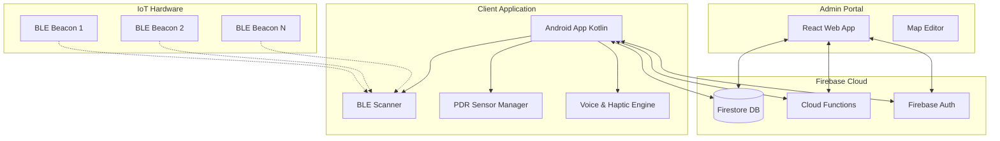

# 🧭 IoT-Guided Indoor Navigation System for Visually Impaired Students


## 📖 Project Overview

The IoT-Guided Indoor Navigation System is an academic proof-of-concept prototype aimed at assisting visually impaired students in navigating independently within a university department building. It utilizes Bluetooth Low Energy (BLE) beacons for indoor positioning through proximity and Pedestrian Dead Reckoning (PDR), without relying on complex fingerprinting. The Android application provides haptic and audio feedback for an accessible user experience, while the Firebase backend supports an Admin Map Editor and other connected features.

### Motivation
Navigating complex indoor spaces like university buildings can be challenging for visually impaired individuals since traditional GPS fails indoors. By deploying low-cost BLE beacons, we can create a scalable, accessible, and inclusive environment that promotes independence and safety.

## 🏗️ System Architecture



## ✨ Key Features

1. **Audio & Haptic Navigation**: Step-by-step guidance utilizing voice commands and vibration patterns, allowing eyes-free use.
2. **Obstacle Detection (Opt-in)**: Utilizes device sensors to warn users of immediate hazards in their path.
3. **Emergency SOS**: Quick-trigger emergency alerts that send the user's current indoor location to campus security or designated contacts.
4. **Schedule Integration**: Automatically retrieves the student's class schedule and provides one-tap navigation to the next classroom.
5. **Voice Commands**: Hands-free operation enabling users to request destinations, ask for their current location, or seek help verbally.
6. **Social Check-ins**: Optional feature to broadcast location securely to friends or study groups within the department.
7. **Admin Map Editor**: A web-based tool for facility managers to add, move, or reconfigure beacon locations and routing graphs dynamically.

## 💻 Technology Stack

| Component | Technology | Description |
|-----------|------------|-------------|
| **Mobile App** | Android (Kotlin) | Primary interface for the visually impaired students. |
| **Backend & DB**| Firebase Firestore | Real-time NoSQL database. |
| **Auth** | Firebase Auth | User authentication and role management. |
| **Cloud Logic** | Firebase Cloud Functions | Serverless API for routing and SOS handling. |
| **Admin UI** | React.js | Web portal for map and beacon management. |
| **IoT Hardware**| BLE Beacons (iBeacon) | Low-energy transmitters for proximity location. |

## 📁 Project Structure

```
.
├── README.md
├── docs/
│   ├── HARDWARE_SETUP.md
│   ├── DEPLOYMENT_GUIDE.md
│   ├── USER_GUIDE.md
│   └── API_REFERENCE.md
├── android-app/          # Kotlin Android Application
├── admin-portal/         # React Admin Web App
└── firebase/             # Cloud Functions & DB Rules
```

## ⚙️ Prerequisites and Setup

### 1. Firebase Setup
1. Create a Firebase Project and enable the Spark (Free) tier.
2. Enable Firestore, Auth (Email/Password), and Storage.
3. Deploy functions from the `/firebase` directory using `firebase deploy --only functions`.

### 2. Android App Setup
1. Install Android Studio.
2. Open the `/android-app` directory.
3. Add your `google-services.json` to the `app/` folder.
4. Build and deploy to a physical Android device (BLE scanning does not work on emulators).

### 3. Admin Portal Setup
1. Navigate to `/admin-portal`.
2. Run `npm install` followed by `npm start`.
3. Configure your `.env` file with Firebase client credentials.

## 💰 Cost Analysis

This system is designed to be highly cost-effective for a single department building setup.

| Item | Quantity | Unit Price | Total Cost |
|------|----------|------------|------------|
| BLE Beacons | ~20 | $12.00 | $240.00 |
| Replacement Batteries | 20 | $0.50 | $10.00 |
| Mounting Tape/Hardware | 1 | $15.00 | $15.00 |
| Firebase Spark Plan | 1 | $0.00 (Free) | $0.00 |
| Domain for Admin Portal| 1 | $12.00/yr | $12.00 |
| Miscellaneous / Buffer | - | - | $23.00 |
| **Total** | | | **~$300.00**|

## 🛠️ Hardware Requirements
- **Server**: Serverless (Firebase)
- **Client**: Android Smartphone (Android 8.0+, BLE support, Magnetometer/Accelerometer)
- **Infrastructure**: Standard BLE iBeacons (e.g., Estimote, Kontakt.io, or generic nRF51822 based beacons).

## 📱 Screenshots

*Note: As this is an accessibility-first app, the UI is highly contrasted and minimalist.*

1. **Login Screen**: [Placeholder: High contrast login screen with voice prompt indicator]
2. **Navigation Screen**: [Placeholder: Large directional arrows with current location text]
3. **Admin Map Editor**: [Placeholder: Web interface showing a floor plan with nodes and edges]

## 🤝 Contributing
Contributions are welcome for academic and research purposes. Please follow the standard fork-and-pull-request workflow.

## 📄 License
This project is licensed under the MIT License. See the LICENSE file for details.

## 🙏 Acknowledgments
- University Disability Services for their guidance on accessibility.
- Open-source Android BLE libraries community.
